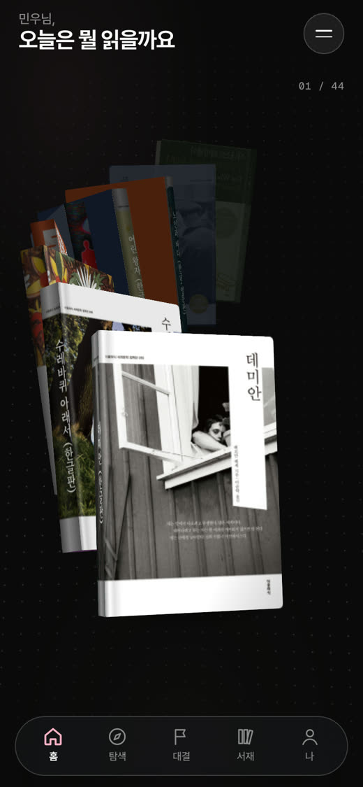
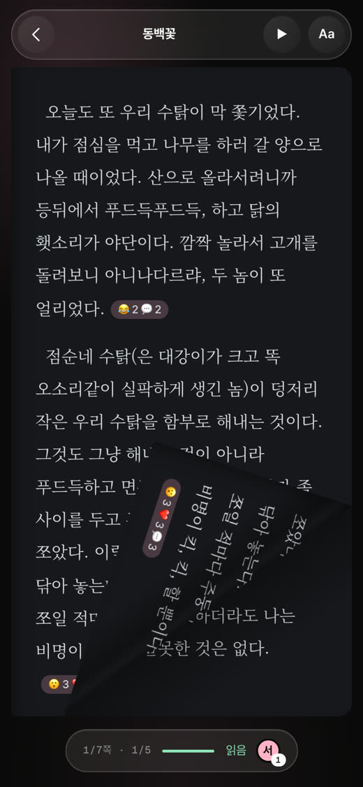
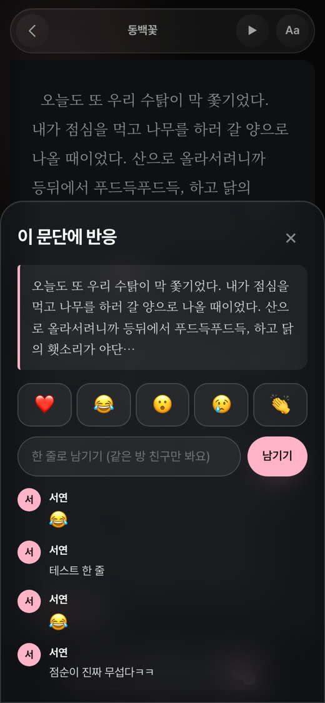
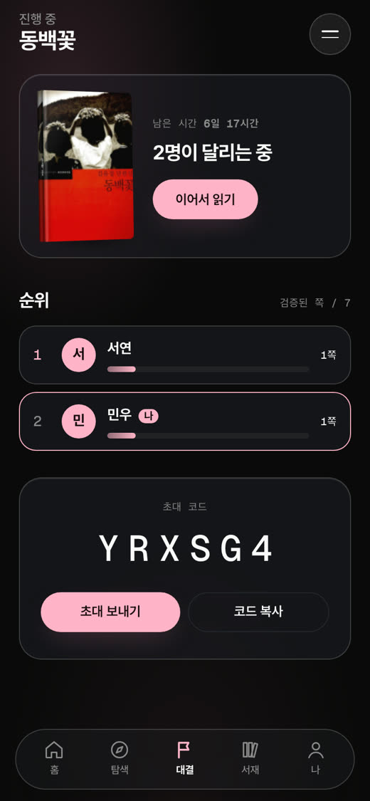
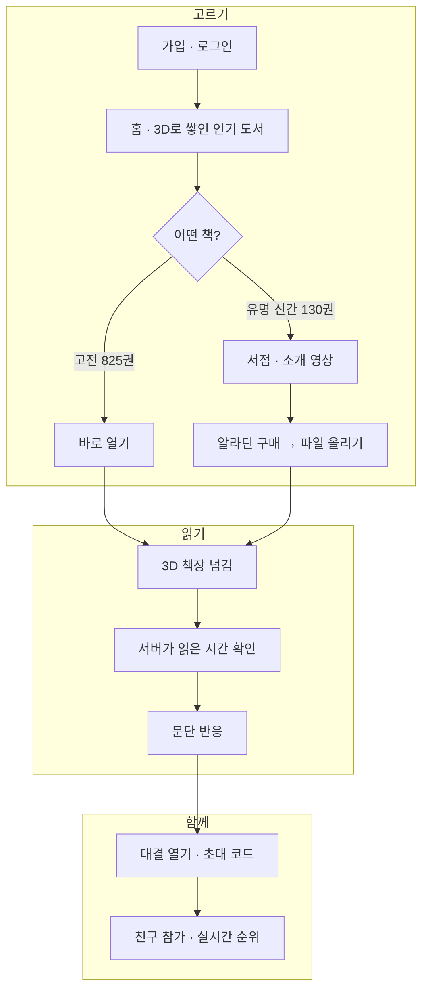
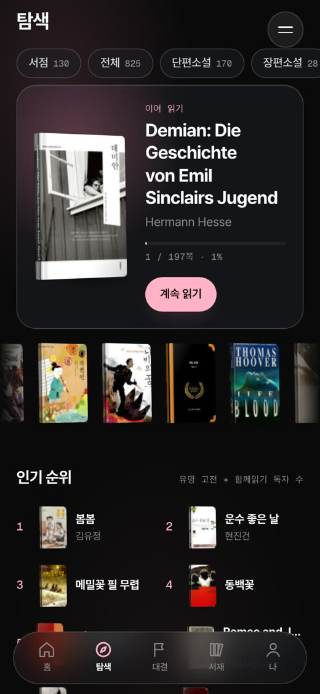
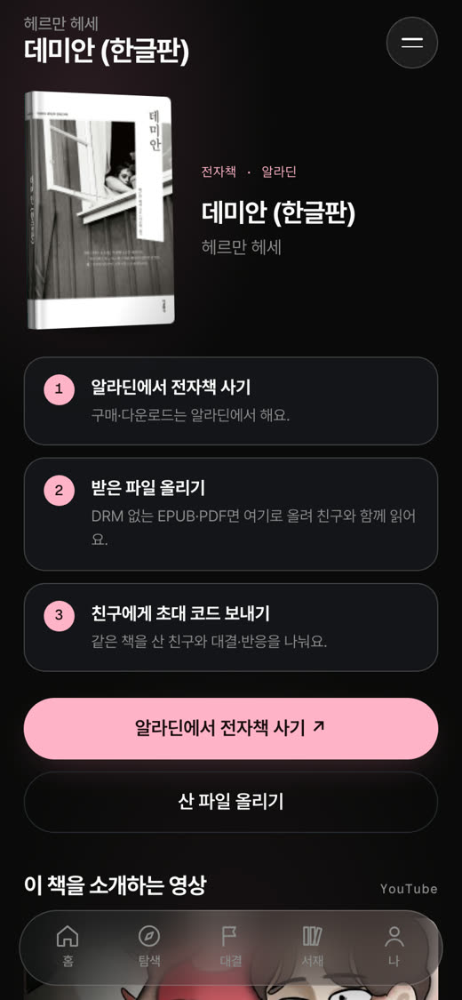
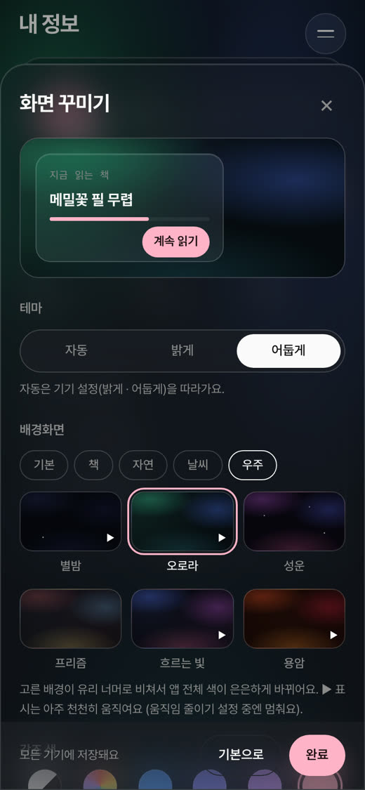
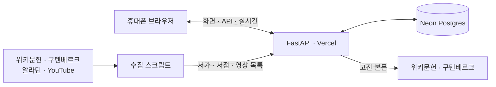

<div align="center">

# 함께읽기

**같은 책을, 각자의 속도로, 함께 읽어요.**

친구와 같은 책을 읽으면 서로 어디까지 읽었는지, 어느 문단에 어떤 반응을 남겼는지 보여요.<br>
초대 코드 하나로 페이지 레이스를 열고, 대충 넘긴 쪽은 점수가 되지 않아요.

[**앱 열기 →**](https://saipr-reading.vercel.app) · [PRD](docs/PRD.md) · [완료 기준](GOAL.md) · [구조](docs/architecture.md)

</div>

| 3D로 쌓인 홈 | 3D 책장 넘김 | 문단 반응 | 친구와 대결 |
|:---:|:---:|:---:|:---:|
|  |  |  |  |

---

## 한눈에

| 읽기 | 함께 | 어디서나 |
|---|---|---|
| 저작권이 끝난 고전 **825권**은 앱에서 전문을 3D로 넘겨 읽어요 | 같은 방 친구의 진행과 **문단 반응**이 보여요. 아직 안 읽은 곳의 반응은 가려져요 | 모바일 웹 앱이라 설치 없이 열려요. 읽던 위치·설정은 계정에 저장돼요 |
| 유명한 신간 **130권**은 알라딘 전자책으로 연결하고, 산 파일을 올려 읽어요 | **초대 코드**로 대결을 열고, 검증된 쪽 수로 순위를 매겨요 | 배경 30종·강조색 12종으로 화면을 꾸며요 |

## 사용 흐름



<details>
<summary><b>화면 전체 보기</b></summary>
<br>

| 로그인 | 홈 | 탐색 | 서점 |
|---|---|---|---|
|  |  |  |  |
| **리더 (3D 넘김)** | **문단 반응** | **대결** | **화면 꾸미기** |
|  |  |  |  |

</details>

## 꼭 지키는 규칙 세 가지

1. **본문은 합법적인 것만** — 앱이 직접 보여 주는 본문은 저작권이 끝난 작품(위키문헌·구텐베르크)뿐이에요. 신간은 정보와 구매 링크만 두고, 사용자가 올린 파일은 올린 사람만 열 수 있어요.
2. **읽은 시간은 서버가 잰다** — 쪽을 펼친 시각부터 서버가 재서, 글자 수에 맞는 최소 시간을 채워야 "읽음"이 돼요. 넘기기만 해서는 레이스 점수가 오르지 않아요.
3. **스포일러는 버그** — 내가 아직 읽지 않은 쪽의 친구 반응은 "🔒 N개"로 개수만 보여요. 실시간 알림에도 반응 내용은 싣지 않아요.

## 구조



| 층 | 쓰는 것 |
|---|---|
| 서버 | Python 3.12 · FastAPI · SQLAlchemy(async) · Alembic |
| 화면 | Jinja2 서버 렌더링 + 바닐라 JS (빌드 단계 없음) · 3D는 CSS transform · 책장 넘김은 StPageFlip |
| 데이터 | Postgres(Neon) · 로컬은 SQLite |
| 실시간 | 로컬은 WebSocket, 배포(서버리스)는 20초 폴링 |
| 배포 | Vercel · CI는 GitHub Actions (테스트 + 실제 Postgres 마이그레이션) |

## 지금까지

| 단계 | 한 일 |
|---|---|
| 기획 | PRD · 완료 기준(GOAL) · 결정 기록(`.grill/`) |
| 기반 | Java 인증 서버를 걷어내고 Python 하나로 통일 (#5) |
| 읽기 | 도서 검색·청크 나누기 → 리더 → 3D 책장 넘김 · 스크롤 모드 |
| 계정 | 이메일 로그인(BCrypt·CSRF·세션 만료) · 프로필 사진 · 화면 꾸미기 |
| 서가 | 퍼블릭 도메인 825권(24개 서가) · 서점 130권 · 북튜버 소개 영상 |
| 함께 | 대결방·초대 코드 · 문단 반응 · 스포일러 가드 · 실시간 알림 |
| 품질 | 코드 리뷰로 10건 수정(체류시간 우회·업로드 DoS·오픈 리다이렉트 등) · 테스트 86개 |
| 배포 | Vercel + Neon, main 머지 (#7) |

## 다음 할 일

- [ ] 실제 iPhone·Android에서 3D 홈·책장 넘김 손맛 확인
- [ ] 소셜 로그인(카카오·구글) · 신간 수동 진행률(트래커 모드)
- [ ] 한줄평 배틀 · 포인트 · 팀 리그 · 푸시 알림
- [ ] 배포판 실시간 알림을 공유 브로커(Postgres LISTEN/NOTIFY 등)로

## 개발하기

```bash
python3.12 -m venv .venv && source .venv/bin/activate
pip install -e ".[dev]"
export DATABASE_URL="sqlite+aiosqlite:///$PWD/scratch-dev.db" DWELL_SCALE=0.06   # 시연용: 최소 읽기 시간 6%
uvicorn app.main:app --port 8011          # http://localhost:8011 (SQLite면 테이블 자동 생성)
pytest -q && ruff check .                  # 테스트는 네트워크 없이 돌아요
```

<details>
<summary><b>폴더 · 데이터 · 배포 메모</b></summary>
<br>

| 경로 | 내용 |
|---|---|
| `app/web.py` · `templates/` · `static/` | 화면 (홈 3D, 탐색, 서점, 리더, 대결, 나) |
| `app/api/` | JSON API · WebSocket |
| `app/services/` | 체류시간 · 서재 · 업로드 파싱 · 대결 · 반응(스포일러 가드) |
| `app/data/` | 서가·서점·인기 순서·소개 영상 목록 |
| `scripts/` | `build_catalog` · `build_store` · `build_videos` · `fetch_covers` |
| `migrations/` · `tests/` | Alembic · pytest 86개 |

- 환경 변수: `DATABASE_URL`, `SECRET_KEY`(배포 필수), `COOKIE_SECURE`, `MAX_UPLOAD_MB`(Vercel은 4), `DWELL_SCALE`(시연용, 기본 1.0)
- 스키마를 바꾸면 배포 **전에** Neon에 `alembic upgrade head`
- 표지 이미지는 시연용으로만 받고 저장소에 올리지 않아요. 알라딘 전자책은 DRM 때문에 앱에서 열 수 없고, 앱에도 그렇게 안내해요.
- 예전 디자인 시안은 [`docs/archive/`](docs/archive/)에 있어요.

</details>
