<div align="center">

# 제목: 미정

**쉬운 독서를 위해**

같은 책을 각자의 속도로 읽으면서 친구의 진행률과 문단 반응이 실시간으로 겹쳐 보이고,
친구와 응원을 주고받고, 팀을 짜서 공정한 페이지 레이스로 경쟁하는 **안드로이드 앱**입니다.
앱 화면부터 서버까지 전부 Python으로 만들었어요.

 **[PRD](docs/PRD.md)** · [앱 설계](docs/plans/2026-10-20-native-app-design.md) · [아키텍처](docs/architecture.md) · [GOAL](GOAL.md) · [앱 README](mobile/README.md) · [Figma](https://www.figma.com/design/mp2nKNmBdJ7Dg2rc2p9rht)

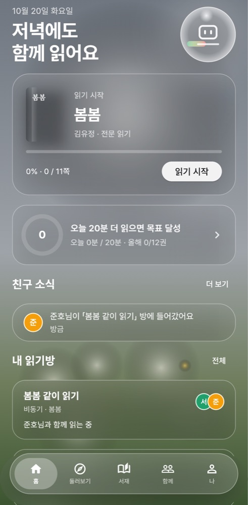 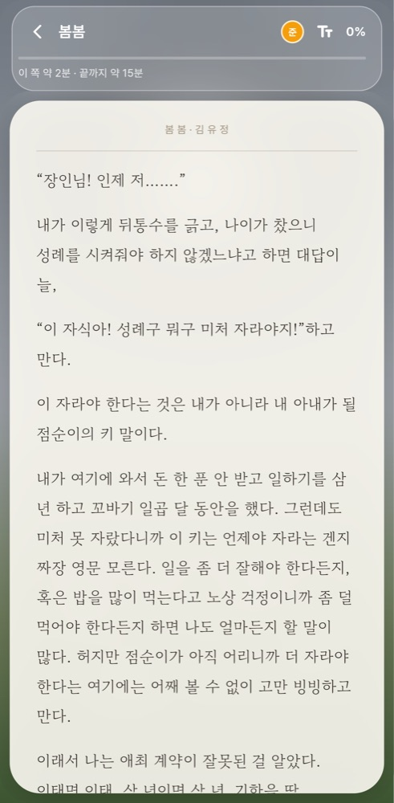 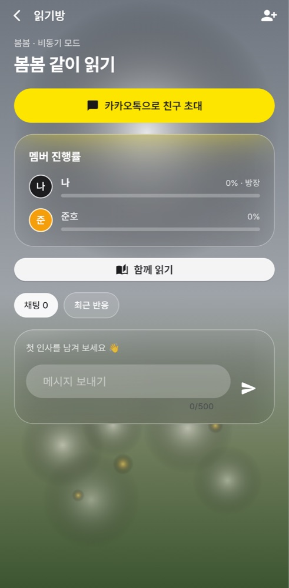

</div>

---

## 왜 만드나

| 기존 | 한계 | 함께읽기 |
|---|---|---|
| 밀리의서재 | 개인 챌린지뿐, 유저 간 대결 없음 | 친구·팀 대항 페이지 레이스 |
| 실시간 함께읽기 서비스 | 같은 시간에 접속해야 함 | **비동기 기본** — 먼저 읽은 친구의 반응이 문단 옆에 남음 |
| 독서 기록 SNS | 다 읽은 뒤 피드 공유에 그침 | **읽는 도중**의 동행 — 친구 피드·응원·밑줄 공유 |
| 공통 | 콘텐츠 라이선싱이 진입장벽 | 본문은 퍼블릭 도메인만, 나머지는 메타데이터 + 진행률 |

타깃: 독서모임은 부담스럽고 혼자 읽기는 지속이 안 되는 대학생·2030. 자세한 페르소나·사용자 스토리·기능 명세·성공 지표는 **[PRD](docs/PRD.md)**.

## 핵심 개념

- **하이브리드 콘텐츠** — 저작권 만료작(위키문헌·Gutendex)은 앱 안 리더로 전문을 읽고, 시판 도서는 카카오·네이버·Google Books 메타데이터와 수동 진행률(트래커 모드)로 기록합니다. 본문 제공 소스는 코드에서 화이트리스트로 강제합니다.
- **청크 = 공통 위치** — 판본·기기마다 달라지는 "페이지" 대신 본문을 결정적으로 나눈 청크를 좌표로 씁니다. 그래서 반응과 밑줄이 모든 사람에게 같은 문단에 겹칩니다.
- **스포일러 가드** — 내가 아직 안 읽은 위치의 반응·밑줄은 내용 없이 "🔒 앞에서 N개의 반응이 기다리고 있어요"로만 보입니다.
- **체류시간 검증** — 청크 글자 수 대비 최소 체류시간을 **서버가** 다시 계산해, 넘기기만 한 구간은 진행률·레이스 점수에서 빠집니다.

## 구성

```
mobile/   Flet(Python) 안드로이드 앱 — 화면 전부        → mobile/README.md
app/      FastAPI 서버 — JSON API · WebSocket · 규칙
          + 웹은 초대 링크 미리보기(/r/{코드})와 로그인·가입만
```

## 빠른 시작

Python 3.12만 있으면 됩니다. Docker·외부 API 키 없이 바로 시연할 수 있어요.

```bash
# 1) 서버
python -m venv .venv && source .venv/bin/activate   # Windows: .venv\Scripts\activate
pip install -e ".[dev]"
python -m app.seed                                   # 샘플 도서 16권 + 데모 계정 4개(서로 팔로우) + 방·팀·레이스
uvicorn app.main:app --host 0.0.0.0 --port 8000

# 2) 앱 (새 터미널)
cd mobile
pip install -e . "flet-cli<1.1" "flet-desktop<1.1" "flet-web<1.1"
flet run src/main.py                                 # 폰 크기 창으로 열려요
```

첫 화면의 **서연으로 시작** · **준호로 시작** 버튼으로 바로 들어갈 수 있어요. 비밀번호는 모두 `demo1234`.

| 계정 | 역할 |
|---|---|
| `seoyeon@demo.kr` (서연) | 「봄봄 같이 읽기」 방장, 팀 봄봄단 |
| `junho@demo.kr` (준호) | 방 멤버, 팀 봄봄단 |
| `doyoon@demo.kr` (도윤) | 팀 동백꽃파 |
| `minji@demo.kr` (민지) | 팀 동백꽃파 |

샘플 도서는 위키문헌 원문 김유정 「봄봄」·「동백꽃」, 현진건 「운수 좋은 날」 등 16권입니다. 모두 사망 후 70년이 지난 작가라 퍼블릭 도메인이고, 인터넷이 없어도 읽을 수 있게 [app/data/](app/data/)에 넣어 두었어요.

**안드로이드 APK**는 JDK 17을 설치한 뒤 `cd mobile && flet build apk`로 만들어요(Flutter는 자동으로 받아요). 자세한 순서와 폰에서 서버 주소 정하는 법은 [mobile/README.md](mobile/README.md)에 있어요.

Postgres로 돌리려면 `cp .env.example .env && docker compose up --build`를 실행하세요. 마이그레이션과 시드가 자동으로 적용됩니다.

## 시연 순서 (5분)

앱 창을 두 개 띄워요(`flet run src/main.py`를 터미널 두 개에서). 하나는 서연, 하나는 준호로 시작해요.

1. **서연 — 홈** → 인사, 이어 읽기 카드, 오늘 목표 링, 친구 소식, 내 읽기방·배틀이 보여요.
2. **서연 — 「봄봄 같이 읽기」 방** → 노란 `카카오톡으로 친구 초대`를 누르면 휴대폰 공유 시트가 떠요(초대 코드 + 웹 미리보기 링크). 링크를 브라우저로 열면 로그인 없이도 방 미리보기와 앱에서 들어오는 방법이 보여요.
3. **준호 — 같은 방 → 채팅** → 메시지를 보내면 서연 화면에 새로고침 없이 바로 떠요.
4. **준호 — `함께 읽기`(리더)** → 첫 쪽을 1분쯤 읽어요(10초마다 서버로 전송). 쪽 아래에 `✓ 읽음`이 붙고 남은 시간("이 쪽 약 2분 · 끝까지 약 15분")이 내 속도에 맞게 바뀌어요. 빨리 넘기기만 하면 인정되지 않아요.
5. **서연 — 방 화면** → 준호의 진행률 막대가 늘어나요. 서연이 리더를 열면 "준호님이 이 쪽을 함께 읽고 있어요"가 보여요.
6. **준호 — 문단을 탭** → 이모지·한줄평. 문단을 길게 누르면 문장을 골라 **밑줄·메모**(색 4종, 친구 공개/나만 보기)도 남겨요. 아직 그 위치를 안 읽은 서연에게는 `잠김 앞에서 1개의 반응이 기다리고 있어요`로만 보여요(스포일러 가드).
7. **함께 탭** → 친구 피드에서 `👏 응원하기`, 친구 코드로 친구 찾기, 리그 순위와 「봄봄단 vs 동백꽃파」 레이스(밤 화면).
8. **나 탭** → 이번 주 그래프, 12주 잔디, 연간 목표, 배지. **설정 → 디자인**에서 글래스 · 머티리얼 · iOS와 다크 모드를 바로 바꿔 보여 주세요.

## 화면

디자인은 앱 안에서 고를 수 있어요. 기본은 처음 시안 **Glass v2**(흐린 사진 배경 위 유리 카드, 떠 있는 유리 탭바)이고, 안드로이드다운 **Material 3**, 아이폰다운 **Cupertino**도 있어요. 셋 다 라이트·다크가 있고, 리더는 어느 디자인에서도 종이 시트(아이보리·세피아·다크) 위 명조로 읽어요.

| 홈 | 둘러보기 | 책 |
|---|---|---|
|  | 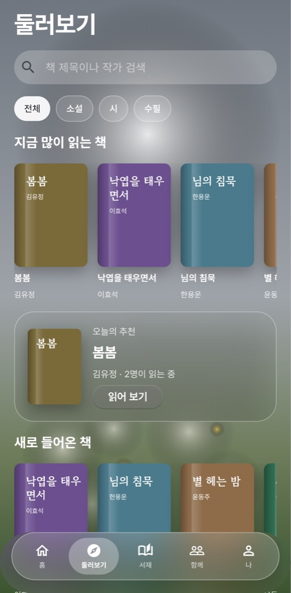 | 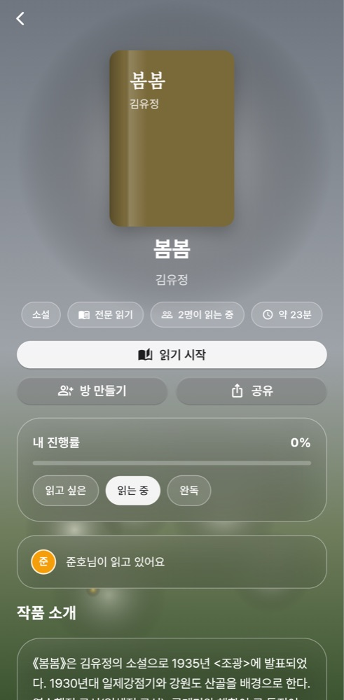 |
| **리더** | **읽기방 · 채팅** | **함께 · 친구 피드** |
|  |  | 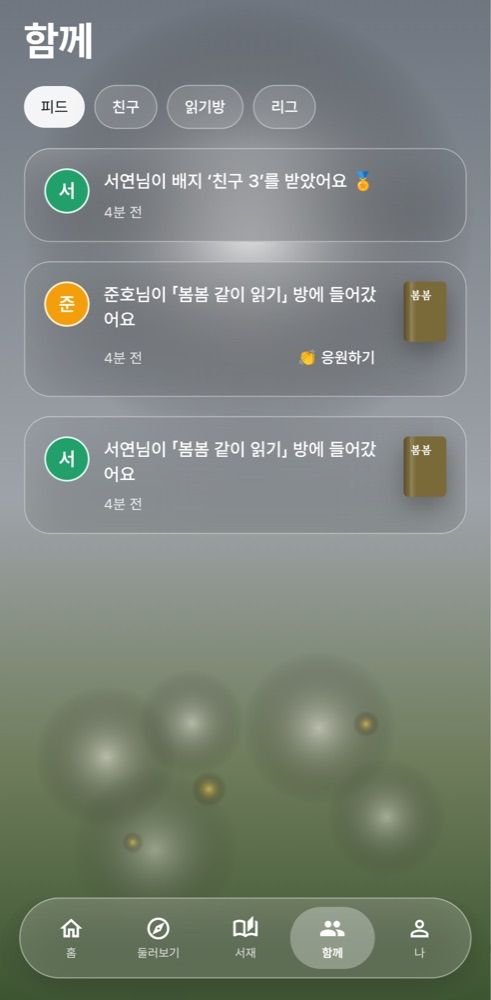 |
| **나 · 통계** | **배틀** | **설정 · 디자인 선택** |
| 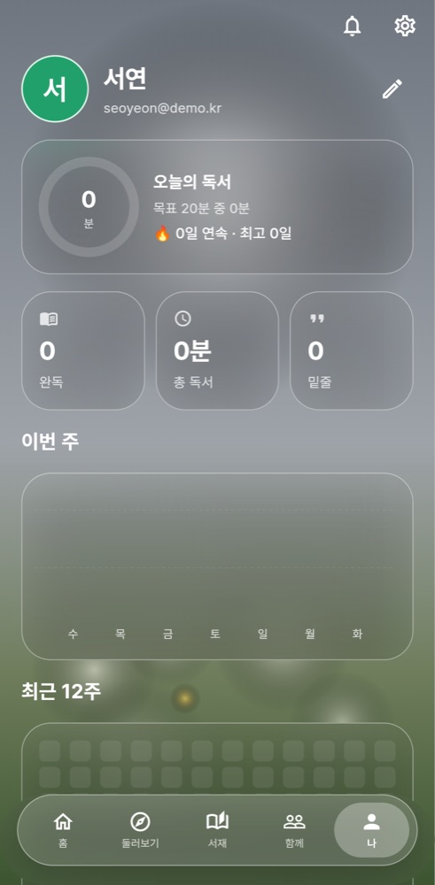 | 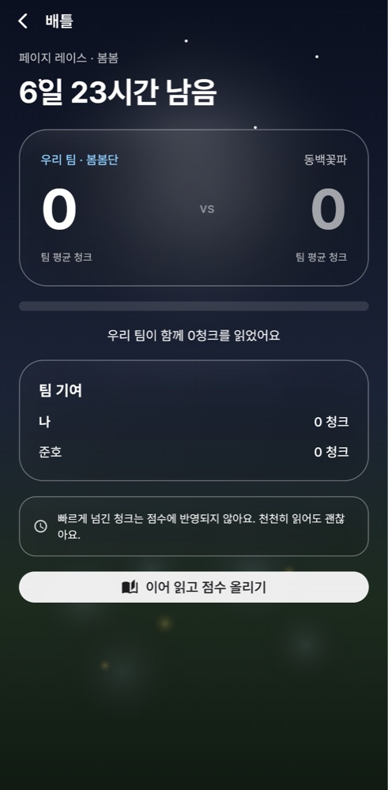 | 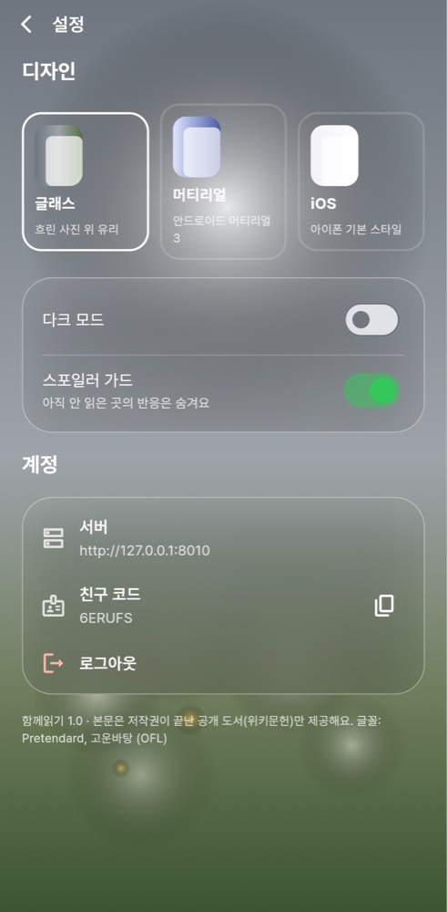 |
| **Material 3** | **Cupertino** | **다크 (글래스)** |
| 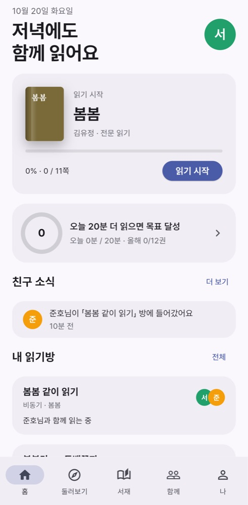 | 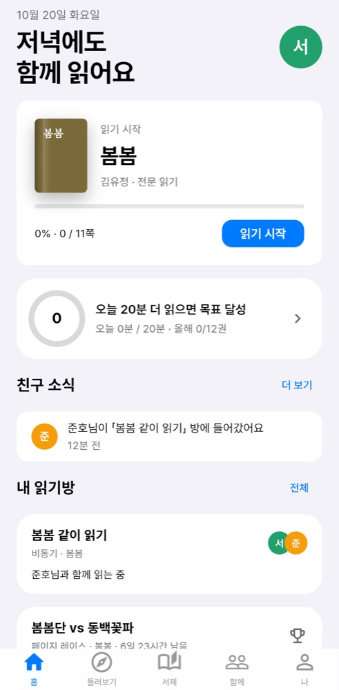 | 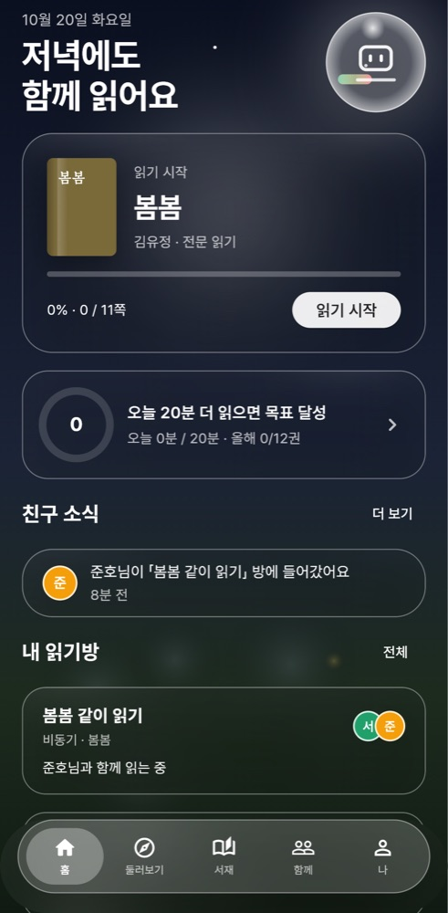 |

## 앱 기술

| 무엇 | 어떻게 보이나 | 기술 |
|---|---|---|
| 진짜 앱 화면 이동 | 화면 스택, 안드로이드 뒤로 가기·예측 뒤로 가기, iOS식 밀어서 뒤로. 책 표지가 다음 화면으로 날아가요 | Flet View 스택 · `PageTransitionsTheme` · `Hero` |
| 실시간 | 방 진행률·채팅·반응·알림이 새로고침 없이 와요. 끊기면 1→30초 간격으로 다시 붙고 놓친 이벤트를 이어 받아요 | WebSocket(`websockets`) · `last_event_id` |
| 정직한 시간 측정 | 다른 앱에 다녀오거나 화면이 꺼지면 독서 시간이 멈춰요 | 단조 시계 · 앱 생명주기 이벤트 |
| 오프라인 | 한 번 연 쪽은 인터넷이 끊겨도 다시 읽히고, 읽은 기록은 모았다가 연결되면 보내요 | 기기 저장소(`SharedPreferences`) · 이벤트 큐 |
| 내 속도에 맞춘 남은 시간 | "이 쪽 약 2분 · 끝까지 약 15분" | 분당 글자 수 지수 평균 |
| 한국어 줄바꿈 | 단어 중간에서 줄이 끊기지 않아요 | 단어 잇기 문자(U+2060)로 `keep-all` 재현 |
| 손맛 | 누르면 살짝 눌리고 진동, 25·50·75·100%마다 축하, 리더를 보는 동안 화면 꺼짐 방지 | `HapticFeedback` · `Wakelock` · 애니메이션 스케일 |
| 공유 | 카카오톡 등 휴대폰 공유 시트로 초대·밑줄 공유 | `Share` · `Clipboard` |
| 차트 | 주간 막대 그래프, 12주 잔디, 목표 링 | `flet-charts` |
| 로딩·오류 | 반짝이는 스켈레톤, 오류 화면의 다시 시도, 세션 만료 시 로그인으로 | `Shimmer` |

## 기능

| 구역 | 기능 |
|---|---|
| 책 | 통합 도서 검색(5개 소스 병렬, 부분 실패 허용) · 장르 · 인기/새 책 · 위키백과 책 소개·작가 소개 · 퍼블릭 도메인 전문 가져오기 · 트래커 모드(% 또는 쪽수) |
| 읽기 | 인앱 리더(글자 4단계 · 간격 3단계 · 명조/고딕 · 종이 3종) · 문단 반응 · 밑줄·메모(색 4종, 친구 공개/나만 보기) · 친구 밑줄 보기 · 스포일러 가드 |
| 서재 | 읽고 싶은 / 읽는 중 / 완독 책장 · 밑줄 모음(공유, 밀어서 삭제) |
| 친구 | 친구 코드로 찾기 · 팔로우 · 하루 한 번 응원 · 친구 피드(완독·배지·방 입장 …) · 프로필(통계·읽는 책·공개 밑줄) |
| 읽기방 | 최대 8명, 비동기/동시 모드 · 초대 코드(7일, 재발급) · 실시간 진행률·프레즌스 · 채팅 · 방장 위임 |
| 경쟁 | 체류시간 검증 페이지 레이스 · 한줄평 배틀(1인 3표) · 팀(최대 6명) · 주간 리그(월 00:00 KST, 10팀씩) |
| 기록 | 오늘 목표 · 연속 기록 · 주간 그래프 · 12주 잔디 · 연간 목표 · 배지 · 포인트 원장 · 챌린지 4종 |
| 알림 | 앱 안 알림함(실시간, 누르면 해당 화면으로) · 방해 금지 22~08시 · 하루 5건 |
| 계정 | 이메일 가입·로그인(앱은 Bearer 토큰) · 소셜 로그인(카카오·구글·네이버, 키 있을 때만 — 웹) |

JSON API 전체는 서버 실행 후 <http://localhost:8000/docs> 에서 볼 수 있어요. 구조와 설계 결정은 [아키텍처](docs/architecture.md).

## 테스트

```bash
pytest -q                  # 서버 147개 — 외부 네트워크 없이 실행 (httpx.MockTransport + SQLite)
cd mobile && pytest -q     # 앱 20개 — 시간 측정 · 큐 · 속도 · API 클라이언트 · 세 디자인 × 라이트/다크 위젯 · 알림 링크
ruff check .
```

GOAL의 검증 항목과 테스트의 대응:

| GOAL | 테스트 |
|---|---|
| 5 · A 방 생성 → B 초대 입장 → A 청크 검증 → B WebSocket 1초 내 수신 | `tests/test_realtime.py::test_e2e_progress_reaches_friend_within_one_second` |
| 6 · 최소 체류시간 미달 청크는 진행률·점수 0 | `tests/test_reading.py` |
| 7 · 검증 위치 뒤 반응은 개수만 | `tests/test_rooms.py::test_spoiler_guard_hides_reactions_ahead` |
| 8 · 화이트리스트 밖 소스는 전문 불가 | `tests/test_rooms.py::test_copyright_guard` |
| 점수·포인트 우회 경로 (코드 리뷰) | `tests/test_integrity.py` |
| 친구·피드·응원·채팅·통계·밑줄·토큰 | `tests/test_social.py` · `test_feed.py` · `test_chat.py` · `test_stats.py` · `test_highlights.py` · `test_tokens.py` |
| 웹(초대 미리보기 · 로그인 · CSRF) | `tests/test_web.py` |

CI(GitHub Actions)는 서버 테스트, 앱 테스트, 실제 Postgres에서 마이그레이션 왕복 · `alembic check` · 시드 · 실시간 E2E를 돌립니다.

## 환경 변수

모두 선택이에요. 없으면 SQLite + 키 없는 소스(위키문헌·Gutendex·Google Books)로 동작합니다. 전체 목록은 [.env.example](.env.example).

| 변수 | 설명 |
|---|---|
| `DATABASE_URL` | 기본 `sqlite+aiosqlite:///./saipr.db`. Postgres는 `postgresql+asyncpg://…` (`postgres://`도 자동 변환) |
| `SECRET_KEY` | 세션 쿠키 서명 키. **배포 시 반드시 변경** |
| `SESSION_COOKIE_SECURE` | HTTPS 배포 시 `true` |
| `PUBLIC_BASE_URL` | 초대 링크·OAuth 콜백 주소 |
| `KAKAO_REST_API_KEY` · `NAVER_CLIENT_ID/SECRET` · `GOOGLE_BOOKS_API_KEY` | 도서 검색 소스 |
| `KAKAO_LOGIN_ENABLED` · `GOOGLE_CLIENT_ID/SECRET` · `NAVER_LOGIN_ENABLED` | 소셜 로그인 버튼 켜기. 콜백: `{PUBLIC_BASE_URL}/auth/{provider}/callback` |
| `SEED_DEMO` | Docker 시작 시 데모 데이터 넣기 (Dockerfile 기본 `true`, `render.yaml`은 `false` — 공개 시연용이면 켜기) |

## 배포

계정 연결이 필요해 실제 배포는 하지 않았고, 설정 파일만 준비했어요.

- **Render**: 저장소를 연결하고 *Blueprint*로 [render.yaml](render.yaml)을 선택하면 웹 서비스 + Postgres가 만들어지고 `SECRET_KEY`는 자동 생성돼요. 배포 후 `PUBLIC_BASE_URL`을 `https://<서비스>.onrender.com`으로 설정하세요.
- **그 밖의 Docker 호스팅**: [Dockerfile](Dockerfile)이 `PORT` 환경변수를 따르고, 시작할 때 `alembic upgrade head`를 실행해요.
- 실시간 브로커가 메모리에 있어서 **인스턴스는 1개**로 운영해야 해요. 여러 개로 늘리려면 `app/realtime/broker.py`를 Redis Pub/Sub 구현으로 바꾸면 돼요(같은 인터페이스).

## 콘텐츠·약관 원칙

- 퍼블릭 도메인이 아닌 본문은 저장·배포하지 않습니다. 트래커 도서는 메타데이터와 진행률만 저장해요.
- 알라딘 Open API는 법인 사업자의 도서정보 서비스 이용 제한 조항 때문에 사용하지 않습니다.
- 외부 검색 결과에는 원 출처 링크를 함께 제공합니다.

## 범위 밖 (다음 단계)

실제 배포 · 스토어 출시(서명 키) · 앱 푸시(FCM) · 카카오톡 공유 SDK · Redis 다중 인스턴스 · 위키문헌 목차 문서 병합(PRD EXC-07) · 탈퇴·개인정보 파기 흐름. 근거는 [GOAL.md](GOAL.md)와 [결정 로그](.grill/phase2-6-python-build.md)에 있어요.

> Phase 1까지 함께 있던 Spring Boot 인증 서버(PR #1)는 같은 기능(이메일 가입·로그인, 비밀번호 해시, 세션 교체, CSRF, 중복 이메일 차단)을 FastAPI로 옮기고 삭제했어요. 원래 코드는 git 기록(`dc3a321`)에 남아 있습니다.
