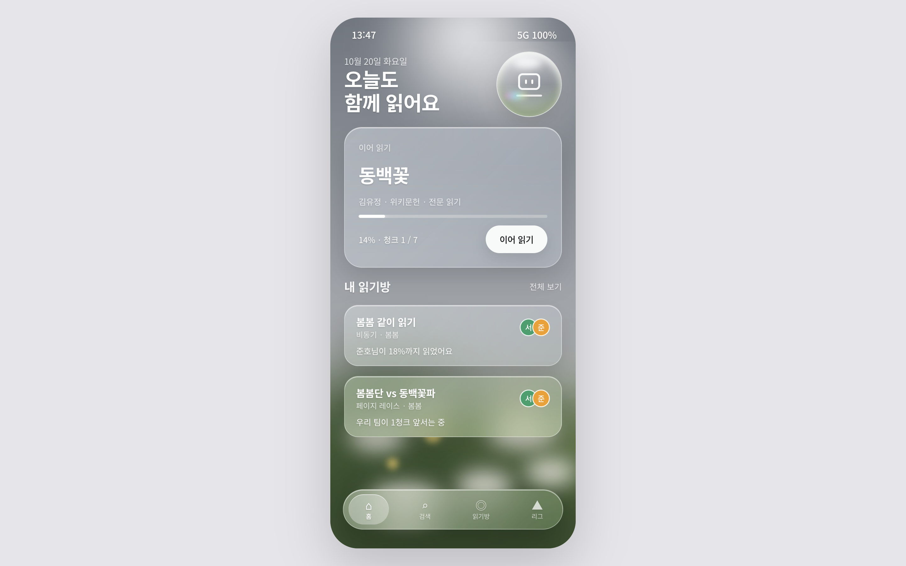
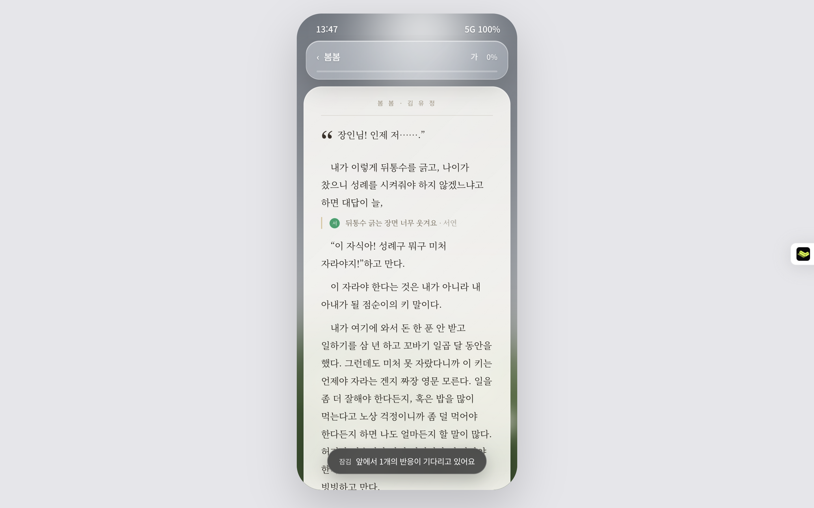
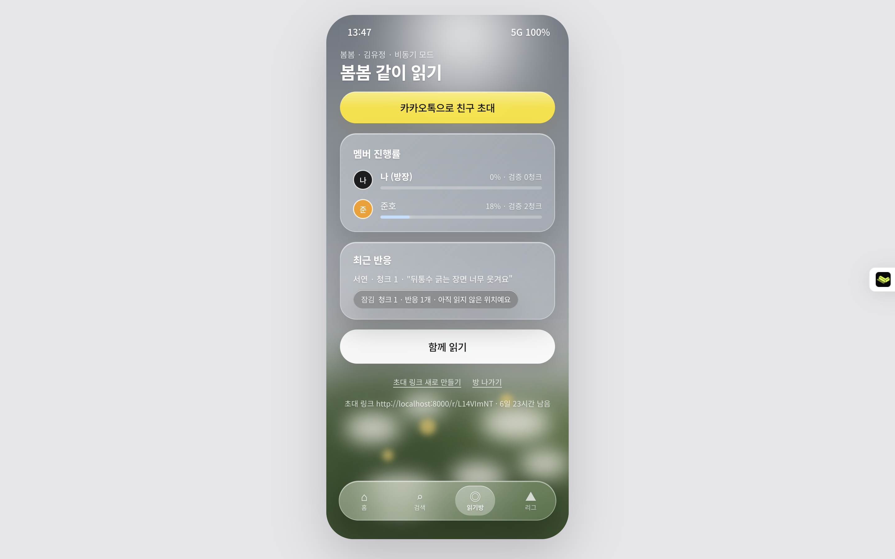
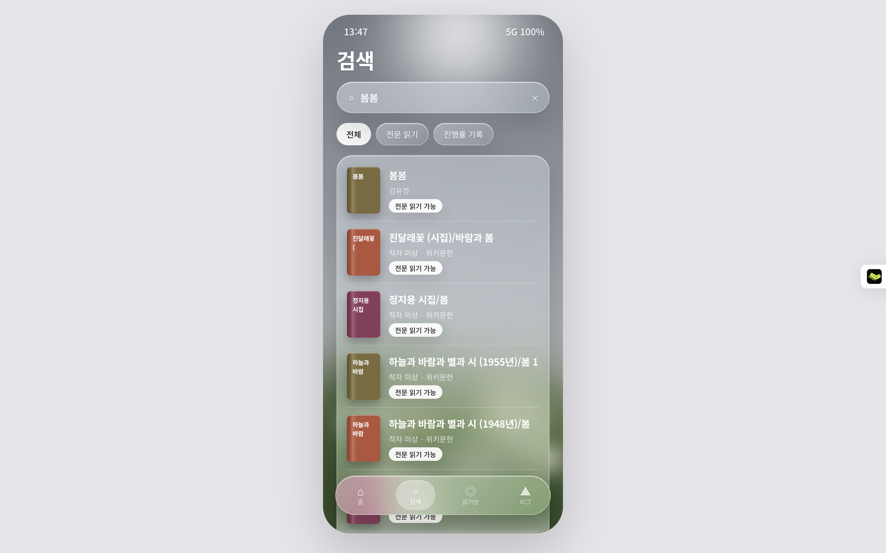
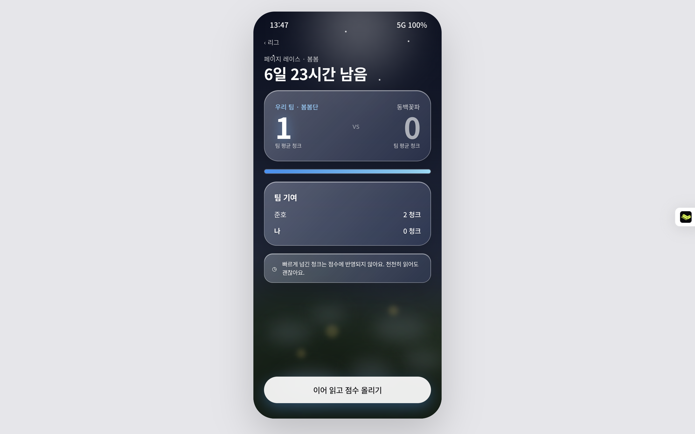
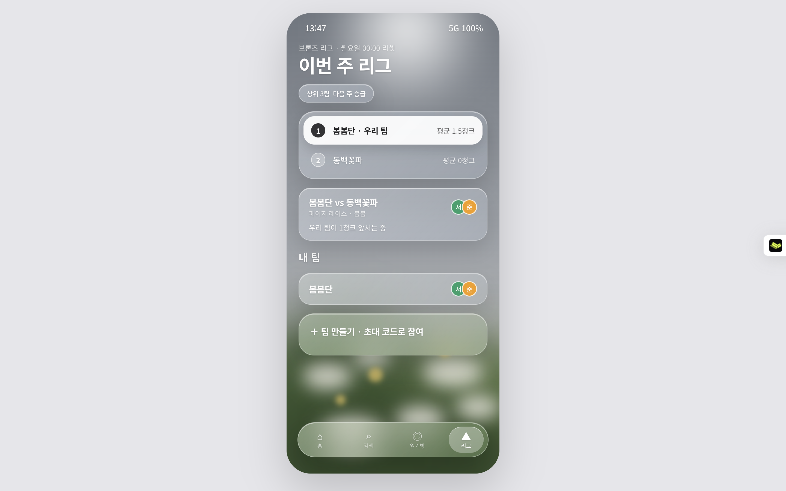

<div align="center">

# 제목: 미정

**쉬운 독서를 위해**

같은 책을 각자의 속도로 읽으면서 친구의 진행률과 문단 반응이 실시간으로 겹쳐 보이고,
팀을 짜서 공정한 페이지 레이스로 경쟁합니다.

 **[PRD](docs/PRD.md)** · [디자인 시스템](docs/design-system.md) · [아키텍처](docs/architecture.md) · [GOAL](GOAL.md) · [Figma](https://www.figma.com/design/mp2nKNmBdJ7Dg2rc2p9rht)

  

</div>

---

## 왜 만드나

| 기존 | 한계 | 함께읽기 |
|---|---|---|
| 밀리의서재 | 개인 챌린지뿐, 유저 간 대결 없음 | 친구·팀 대항 페이지 레이스 |
| 실시간 함께읽기 서비스 | 같은 시간에 접속해야 함 | **비동기 기본** — 먼저 읽은 친구의 반응이 문단 옆에 남음 |
| 독서 기록 SNS | 다 읽은 뒤 피드 공유에 그침 | **읽는 도중**의 동행 |
| 공통 | 콘텐츠 라이선싱이 진입장벽 | 본문은 퍼블릭 도메인만, 나머지는 메타데이터 + 진행률 |

타깃: 독서모임은 부담스럽고 혼자 읽기는 지속이 안 되는 대학생·2030. 자세한 페르소나·사용자 스토리·기능 명세·성공 지표는 **[PRD](docs/PRD.md)**.

## 핵심 개념

- **하이브리드 콘텐츠** — 저작권 만료작(위키문헌·Gutendex)은 앱 안 리더로 전문을 읽고, 시판 도서는 카카오·네이버·Google Books 메타데이터와 수동 진행률(트래커 모드)로 기록합니다. 본문 제공 소스는 코드에서 화이트리스트로 강제합니다.
- **청크 = 공통 위치** — 판본·기기마다 달라지는 "페이지" 대신 본문을 결정적으로 나눈 청크를 좌표로 씁니다. 그래서 반응이 모든 사람에게 같은 문단에 겹칩니다.
- **스포일러 가드** — 내가 아직 안 읽은 위치의 반응은 내용 없이 "🔒 앞에서 N개의 반응이 기다리고 있어요"로만 보입니다.
- **체류시간 검증** — 청크 글자 수 대비 최소 체류시간을 **서버가** 다시 계산해, 넘기기만 한 구간은 진행률·레이스 점수에서 빠집니다.

## 빠른 시작

Python 3.12만 있으면 됩니다. Docker·외부 API 키 없이 바로 시연할 수 있어요.

```bash
python -m venv .venv && source .venv/bin/activate   # Windows: .venv\Scripts\activate
pip install -e ".[dev]"
python -m app.seed                                   # 샘플 도서 3권 + 데모 계정 4개 + 방·팀·레이스
uvicorn app.main:app --reload
```

브라우저에서 <http://localhost:8000> 을 열고 데모 계정으로 로그인합니다. 비밀번호는 모두 `demo1234`.

| 계정 | 역할 |
|---|---|
| `seoyeon@demo.kr` (서연) | 「봄봄 같이 읽기」 방장, 팀 봄봄단 |
| `junho@demo.kr` (준호) | 방 멤버, 팀 봄봄단 |
| `doyoon@demo.kr` (도윤) | 팀 동백꽃파 |
| `minji@demo.kr` (민지) | 팀 동백꽃파 |

샘플 도서는 위키문헌 원문 김유정 「봄봄」·「동백꽃」, 현진건 「운수 좋은 날」입니다. 세 작가 모두 사망 후 70년이 지나 퍼블릭 도메인이고, 인터넷이 없어도 읽을 수 있게 [app/data/](app/data/)에 넣어 두었어요.

Postgres로 돌리려면 `cp .env.example .env && docker compose up --build`를 실행하세요. 마이그레이션과 시드가 자동으로 적용됩니다.

## 시연 순서 (5분)

브라우저 창 두 개를 띄웁니다. 하나는 일반 창, 하나는 시크릿 창이에요.

1. **창 A — 서연 로그인** → 홈. "오늘도 함께 읽어요", 이어 읽기 카드, 내 읽기방, 진행 중인 레이스가 보여요.
2. **창 A — 「봄봄 같이 읽기」 방 열기** → 노란 `카카오톡으로 친구 초대`를 누릅니다. 휴대폰이면 공유 시트(카카오톡 포함)가 뜨고, PC면 초대 링크가 복사돼요.
3. **창 B — 초대 링크 붙여넣기** → 로그인 전에도 방 미리보기(책·멤버·진행률)가 보여요 → `가입하고 참여하기` → 가입하면 같은 초대 화면으로 돌아와요 → `참여하기`.
4. **창 A의 방 화면** — 새로고침하지 않아도 멤버 진행률에 새 친구가 나타나고 "○○님이 들어왔어요" 알림이 떠요.
5. **창 B — `함께 읽기`(리더)** → 첫 쪽을 1분 정도 읽어요(10초마다 서버로 전송). 쪽번호 옆에 `✓ 읽음`이 붙고 `+1P` 알림이 떠요.
   - 빨리 넘기기만 하면 인정되지 않고 "천천히 읽어도 괜찮아요"가 떠요.
6. **창 A의 방 화면** — B의 진행률 막대가 늘어나요. 창 A의 리더에는 "○○님이 이 쪽을 함께 읽고 있어요"가 보여요.
7. **창 B — 문단을 탭** → 이모지·한줄평 남기기. **창 A의 리더**에서는 아직 그 위치를 안 읽었으니 아래에 `잠김 앞에서 1개의 반응이 기다리고 있어요`로만 보여요(스포일러 가드). 홈의 유리 구슬 → 내 정보 → 스포일러 가드를 끄면 보여요.
8. **리그 탭** → 이번 주 리그 순위와 「봄봄단 vs 동백꽃파」 레이스(밤 화면). **봄봄단 → 다른 팀에 도전하기**로 레이스·한줄평 배틀을 만들 수 있어요. 유리 구슬을 누르면 포인트·챌린지·알림함이 있어요.

## 화면

디자인은 처음 만든 시안 **Glass v2**를 그대로 옮겼어요. 흐린 사진 같은 배경 위에 유리 카드가 떠 있고, 흰 알약 버튼과 떠 있는 유리 탭바, 친구마다 색이 다른 동그라미 아바타를 써요. 리더는 유리 상단바 아래 아이보리 종이 시트에 명조로 읽고, 레이스는 밤하늘 화면으로 바뀌어요. 휴대폰에서는 화면 전체, PC에서는 가운데 폰 크기 화면으로 보여요. 재질·토큰은 [디자인 시스템](docs/design-system.md)에 있어요.

| 홈 | 검색 | 리더 |
|---|---|---|
|  |  |  |
| **읽기방** | **레이스** | **팀·리그** |
|  |  |  |

처음 시안 HTML(A Glass · B Paper)은 [docs/mockups/archive/](docs/mockups/archive/)에 있어요.

## 기능

| Phase | 기능 | 화면 · API |
|---|---|---|
| 1 | 통합 도서 검색(5개 소스 병렬, 부분 실패 허용) · 퍼블릭 도메인 전문 가져오기 · 청크화 | `/search` |
| 2 | 이메일 가입·로그인 · 소셜 로그인(카카오·구글·네이버, 키 있을 때만) · 내 서재(읽고 싶은/읽는 중/완독) · 인앱 리더(글자 4단계·배경 3종) · 트래커 모드(% 또는 쪽수) | `/login` `/books/{id}` `/books/{id}/read` |
| 3 | 읽기방(최대 8명, 비동기/동시 모드) · 8자리 초대 링크(7일, 재발급) · WebSocket 실시간 진행률·프레즌스 · 문단 반응 · 스포일러 가드 · 방장 위임 | `/rooms/{id}` `/r/{code}` |
| 4 | 체류시간 검증 페이지 레이스 · 한줄평 배틀(1인 3표) · 포인트 원장 · 챌린지 4종. 배틀 중에는 팀원이 고정되고, 완독 포인트는 앱에서 끝까지 읽은 책만 | `/battles/{id}` `/me` |
| 5 | 팀(최대 6명, 초대 코드) · 주간 리그(월 00:00 KST 기준, 10팀씩) | `/teams` |
| 6 | 앱 내 알림함(추월·반응·배틀·입장) · 방해 금지 22~08시 · 하루 5건 · 배포 설정 | `/me` · `render.yaml` |

JSON API 전체는 서버 실행 후 <http://localhost:8000/docs> 에서 볼 수 있어요. 구조와 설계 결정은 [아키텍처](docs/architecture.md).

## 테스트

```bash
pytest -q        # 100개 — 외부 네트워크 없이 실행 (httpx.MockTransport + SQLite)
ruff check .
```

GOAL의 검증 항목과 테스트의 대응:

| GOAL | 테스트 |
|---|---|
| 5 · A 방 생성 → B 초대 입장 → A 청크 검증 → B WebSocket 1초 내 수신 | `tests/test_realtime.py::test_e2e_progress_reaches_friend_within_one_second` |
| 6 · 최소 체류시간 미달 청크는 진행률·점수 0 | `tests/test_reading.py` |
| 7 · 검증 위치 뒤 반응은 개수만 | `tests/test_rooms.py::test_spoiler_guard_hides_reactions_ahead` |
| 8 · 화이트리스트 밖 소스는 전문 불가 | `tests/test_rooms.py::test_copyright_guard` |
| 점수·포인트 우회 경로 (코드 리뷰) | `tests/test_integrity.py` |

CI(GitHub Actions)는 SQLite 테스트와 함께, 실제 Postgres에서 마이그레이션 왕복 · `alembic check` · 시드 · 실시간 E2E를 돌립니다.

## 환경 변수

모두 선택이에요. 없으면 SQLite + 키 없는 소스(위키문헌·Gutendex·Google Books)로 동작합니다. 전체 목록은 [.env.example](.env.example).

| 변수 | 설명 |
|---|---|
| `DATABASE_URL` | 기본 `sqlite+aiosqlite:///./saipr.db`. Postgres는 `postgresql+asyncpg://…` (`postgres://`도 자동 변환) |
| `SECRET_KEY` | 세션 쿠키 서명 키. **배포 시 반드시 변경** |
| `SESSION_COOKIE_SECURE` | HTTPS 배포 시 `true` |
| `PUBLIC_BASE_URL` | 초대 링크·OAuth 콜백 주소 |
| `KAKAO_REST_API_KEY` · `NAVER_CLIENT_ID/SECRET` · `GOOGLE_BOOKS_API_KEY` | 도서 검색 소스 |
| `KAKAO_LOGIN_ENABLED` · `GOOGLE_CLIENT_ID/SECRET` · `NAVER_LOGIN_ENABLED` | 소셜 로그인 버튼 켜기. 콜백: `{PUBLIC_BASE_URL}/auth/{provider}/callback` |
| `SEED_DEMO` | Docker 시작 시 데모 데이터 넣기 (Dockerfile 기본 `true`, `render.yaml`은 `false` — 공개 시연용이면 켜기) |

## 배포

계정 연결이 필요해 실제 배포는 하지 않았고, 설정 파일만 준비했어요.

- **Render**: 저장소를 연결하고 *Blueprint*로 [render.yaml](render.yaml)을 선택하면 웹 서비스 + Postgres가 만들어지고 `SECRET_KEY`는 자동 생성돼요. 배포 후 `PUBLIC_BASE_URL`을 `https://<서비스>.onrender.com`으로 설정하세요.
- **그 밖의 Docker 호스팅**: [Dockerfile](Dockerfile)이 `PORT` 환경변수를 따르고, 시작할 때 `alembic upgrade head`를 실행해요.
- 실시간 브로커가 메모리에 있어서 **인스턴스는 1개**로 운영해야 해요. 여러 개로 늘리려면 `app/realtime/broker.py`를 Redis Pub/Sub 구현으로 바꾸면 돼요(같은 인터페이스).

## 콘텐츠·약관 원칙

- 퍼블릭 도메인이 아닌 본문은 저장·배포하지 않습니다. 트래커 도서는 메타데이터와 진행률만 저장해요.
- 알라딘 Open API는 법인 사업자의 도서정보 서비스 이용 제한 조항 때문에 사용하지 않습니다.
- 외부 검색 결과에는 원 출처 링크를 함께 제공합니다.

## 범위 밖 (다음 단계)

FCM 푸시 · 실제 배포 · 카카오톡 공유 SDK · Redis 다중 인스턴스 · 위키문헌 목차 문서 병합(PRD EXC-07) · 탈퇴·개인정보 파기 흐름. 근거는 [GOAL.md](GOAL.md)와 [결정 로그](.grill/phase2-6-python-build.md)에 있어요.

> Phase 1까지 함께 있던 Spring Boot 인증 서버(PR #1)는 같은 기능(이메일 가입·로그인, 비밀번호 해시, 세션 교체, CSRF, 중복 이메일 차단)을 FastAPI로 옮기고 삭제했어요. 원래 코드는 git 기록(`dc3a321`)에 남아 있습니다.
